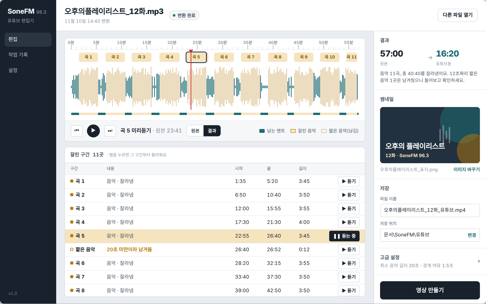

# radio2yt — 라디오 방송을 유튜브 영상으로

라디오 송출용 mp3에서 **긴 음악(곡)만 자동으로 잘라내고**, 진행자 멘트는 배경음악이 깔려 있어도 그대로 남긴 뒤, 썸네일 한 장을 고정 화면으로 붙여 유튜브용 mp4를 만드는 Windows 프로그램입니다. 공동체 라디오 방송국 SoneFM 96.3의 내부 편집용으로 만들었습니다.



## 하는 일

1. mp3를 끌어다 놓고 썸네일을 고릅니다.
2. 음성/음악 판별 모델이 방송을 분석해서 **20초 이상 이어지는 음악**만 찾아냅니다. 57분 방송 기준 약 30초가 걸립니다.
3. 결과 화면에서 잘린 곳을 확인합니다.
   - 파형을 누르면 그 지점부터 재생합니다.
   - **[원본]** 곡 시작 5초 전부터 들려줍니다.
   - **[이음새]** 결과 영상에서 잘린 지점 앞뒤 5초를 들려줍니다.
4. **[영상 만들기]**를 누르면 1920×1080 mp4가 만들어집니다.

멘트를 지키는 쪽으로 보수적으로 자릅니다.
- 멘트(speech)로 판별된 곳은 자르지 않습니다.
- 자르는 구간의 양 끝을 1초씩 줄여서 남깁니다.
- 이음새에는 0.3초 페이드를 넣습니다.
- 20초 미만의 짧은 음악(징글 등)은 남기고, 화면에 "짧은 음악"으로 표시합니다.

## 설치

[Releases](../../releases/latest)에서 `SoneFM-YoutubeEditor-Setup-<버전>.exe`를 받아 실행합니다. 관리자 권한은 필요 없습니다. ffmpeg와 판별 모델이 들어 있어 인터넷이 없어도 동작합니다.

서명되지 않은 실행 파일이라 "Windows의 PC 보호" 경고가 뜰 수 있습니다. 그때는 **추가 정보 → 실행**을 누르세요.

## 개발

```
python -m venv .venv
.venv\Scripts\python -m pip install -r requirements.txt
.venv\Scripts\python -m app          # 화면 실행 (또는 실행.bat)
```

ffmpeg가 PATH에 있어야 합니다.

명령줄로도 쓸 수 있습니다. 폴더를 주면 같은 이름의 이미지를 썸네일로 씁니다.
```
.venv\Scripts\python radio2yt.py input\                       # 폴더 안 오디오 전부
.venv\Scripts\python radio2yt.py ep01.mp3 --thumb ep01.jpg
.venv\Scripts\python radio2yt.py ep01.mp3 --dry-run           # 분석만
```

### 설치 파일 만들기

[Inno Setup 6](https://jrsoftware.org/isinfo.php)이 필요합니다.
```
.\packaging\build.ps1      # → dist\installer\SoneFM-YoutubeEditor-Setup-<버전>.exe
```

버전은 `app/__init__.py`의 `__version__`에서 바꿉니다.

### 문제 확인

- 설치판 엔진 점검: `SoneFMEditor.exe --selftest 파일.mp3` → `%APPDATA%\SoneFM 유튜브 편집기\selftest.txt`
- 오류 로그: `%APPDATA%\SoneFM 유튜브 편집기\log.txt`

## 구조

| 경로 | 내용 |
|---|---|
| `engine/segmenter.py` | 음성/음악/잡음 판별. inaSpeechSegmenter의 처리 흐름을 TensorFlow 없이 onnxruntime으로 옮김. 원본과 같은 결과 |
| `engine/pipeline.py` | 자를 구간 결정, 결과 오디오, mp4 생성 (ffmpeg) |
| `app/` | PySide6 화면. 디자인 기준은 `design/DESIGN.md` |
| `radio2yt.py` | 명령줄 버전 |
| `packaging/` | PyInstaller와 Inno Setup 설정 |
| `tools/convert_model.py` | Keras 모델을 ONNX로 변환 (개발용, `requirements-dev.txt`) |

요구사항과 결정 기록은 [REQUIREMENTS.md](REQUIREMENTS.md)에 있습니다.

## 라이선스

[MIT](LICENSE). 포함된 외부 구성 요소는 각자의 라이선스를 따릅니다. `engine/vendor/sidekit_mfcc.py`가 LGPL-3.0인 것을 포함해 자세한 내용은 [THIRD_PARTY_NOTICES.md](THIRD_PARTY_NOTICES.md)를 참고하세요.

음성/음악 판별 모델은 [inaSpeechSegmenter](https://github.com/ina-foss/inaSpeechSegmenter)(INA, MIT)를 변환해서 씁니다.
